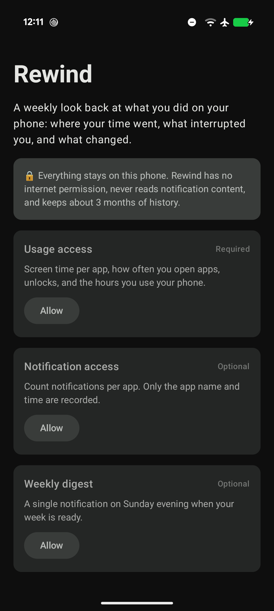
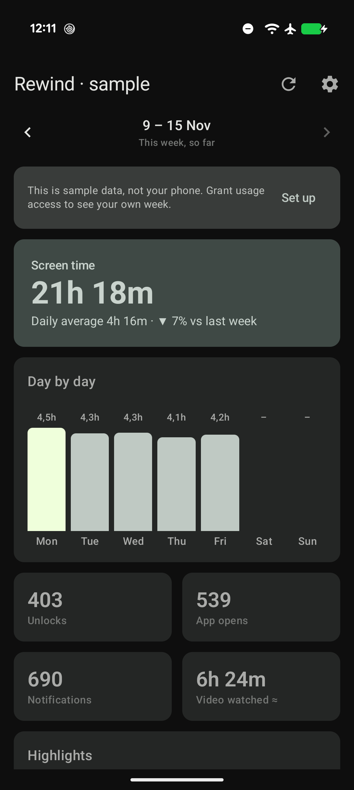
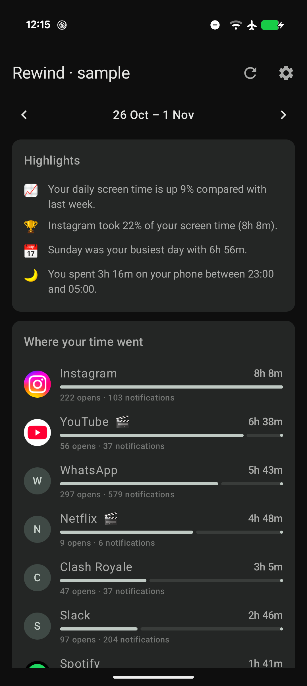
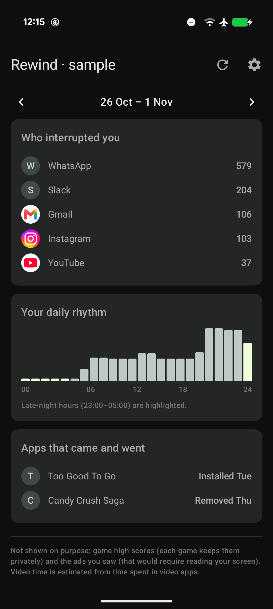
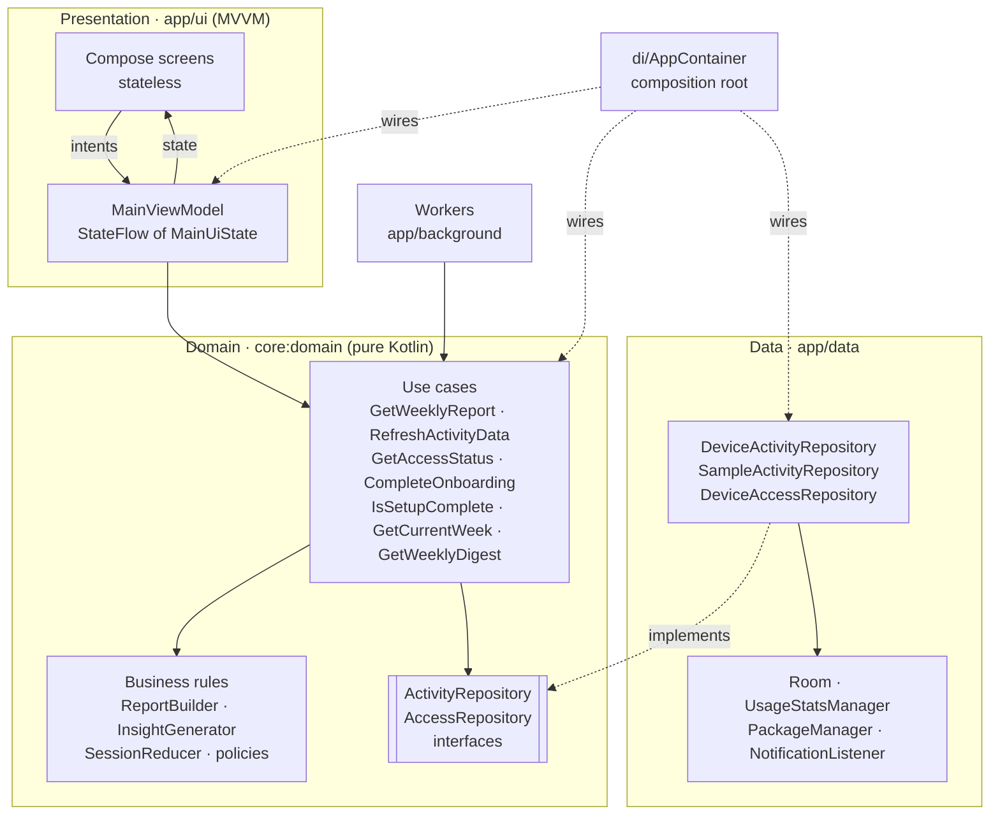

# Rewind: a weekly activity report for your phone

> *"A user would like to be able to review what they did and saw on their phone during the week.
> What trade-offs would you make to offer them a solution that is comprehensive, efficient and/or practical, and why?"*

Rewind is a native Android app (Kotlin, Jetpack Compose) that builds a weekly report of how the phone was used:
screen time per app, day-by-day and hour-by-hour patterns, unlocks, app opens, notifications received per app,
apps installed and removed, an estimate of video watched, a comparison with the previous week, and a few
automatically chosen highlights. A digest notification arrives on Sunday evening.

Everything is computed and stored on the device. The app doesn't even request the `INTERNET` permission.

| | |
|---|---|
| **Stack** | Kotlin 2.0 · Jetpack Compose (Material 3) · Coroutines/Flow · Room · WorkManager · `UsageStatsManager` · `NotificationListenerService` |
| **Architecture** | MVVM + Clean Architecture: presentation → domain (use cases, repository interfaces) ← data |
| **Modules** | `:core:domain` (pure Kotlin: entities, use cases, repository contracts, business rules) · `:app` (Android: data layer, presentation, DI) |
| **Min / target SDK** | 29 / 35 |
| **Try it without granting anything** | "Explore with sample data" on the first screen |

<!--
Screenshots:
| Onboarding | Report | Where your time went | Apps that came and went |
|---|---|---|---|
|  |  |  |  |
-->

## 1. Assumptions

I'd start with Android. With the user's permission, an Android app can read real usage data from the system. On
iOS, Screen Time data stays inside Apple's sandbox, so a third-party app only gets a limited view.

The user is the only person looking at this data. It's meant for self-reflection, so parents and employers are
out of scope. Because of that, everything stays on the phone. There's no backend and no account, and nothing gets
synced. Keeping it local means I don't have to worry about GDPR or securing a server, and it's a lot easier to ask
people to trust the app.

There's one catch I only noticed when I looked at the API. Android keeps detailed usage events for just a few
days, so the app can't wait until Sunday and ask for the whole week. It has to collect during the week and save
the data before the system throws it away.

Battery matters too. If an app that's supposed to help you understand your phone ends up draining it, people will
uninstall it, and honestly they'd be right.

## 2. What's realistic and what isn't

I went through each idea and was honest about whether I could deliver it properly.

| Data point | How | Decision |
|---|---|---|
| Time per app | `UsageStatsManager` events | Yes, this is the core |
| Opens / closes | Same events | Yes, comes for free |
| Phone unlocks | Keyguard / screen events | Yes, often more revealing than total time |
| Notifications | `NotificationListenerService`, counting only | Yes, but opt-in |
| Installed / deleted apps | `getChangedPackages()` once a day | Yes, cheap |
| Video watched | Active media sessions + foreground app | Estimate only, labelled as such |
| Game high scores | No shared API | Later, maybe via partner games |
| Most-advertised product | Would need to read the screen | No |

## 3. Trade-offs

The first one is how much to collect versus how much to ask for. Every extra permission is another chance for the
user to decide the app isn't worth it. So only usage access is required, and that alone covers most of the recap.
Notification and media tracking stay off until the user turns them on, and the app explains what each one is for
before asking. If someone says no, they still get a recap, just a smaller one.

The second one is accuracy versus battery. A background service watching the phone in real time would be the most
precise option, but it's wasteful when Android already records these events. Instead, a WorkManager job runs about
every six hours when conditions are good for the battery, and copies whatever's new since the last run. I'd keep
raw events for two weeks and daily totals for a year. That's enough to say "less than last week", and the raw data
should stay under a megabyte.

The third one is detail versus readability. Nobody wants to scroll through 47 rows of stats on a Sunday night, so
the recap is five or six cards with one point each:

- Total screen time, compared to last week
- Your top three apps
- How often you unlocked your phone, and at what times
- Your noisiest app: how many notifications it sent vs. how often you actually opened it
- What changed: new apps, deleted apps, anything that suddenly spiked
- Roughly how much video you watched, if you turned that on

The noisiest-app card is my favourite. Say an app sent you 300 notifications and you opened it four times. You
don't need me to tell you what to do with that, and the card can link straight to that app's notification settings.

## 4. Architecture

### Tech stack decision

- **Context.** The data only exists inside the operating system.
- **Options.** A cross-platform app (Flutter, React Native, KMP) or native Android.
- **Decision.** Native Android: Kotlin, Jetpack Compose with Material 3, Coroutines and StateFlow, Room, WorkManager.
- **Why.** Android lets an app read usage events and notifications once the user allows it. On iOS, Screen Time
  data stays inside a sandboxed extension, so a cross-platform app wouldn't get more data.
- **Consequence.** The report logic is plain Kotlin with no Android code, so it can move to KMP later.

### MVVM + Clean Architecture, sized to the problem

- **Domain layer** (`:core:domain`, pure Kotlin, no Android): entities, business rules, use cases and the
  repository interfaces it needs. It depends on nothing; everything else depends on it (dependency inversion).
- **Data layer** (`app/data`): implements `ActivityRepository` and `AccessRepository` with Room, `UsageStatsManager`,
  `PackageManager` and the notification listener. Repositories only load and map data; they hold no business rules.
- **Presentation layer** (`app/ui`): MVVM. `MainViewModel` receives only use cases through its constructor and
  exposes one immutable `StateFlow<MainUiState>`. Composables are stateless: they render state and send intents
  (`onContinueClicked()`, `onPreviousWeekClicked()`, …), so data flows one way.
- **Composition root** (`di/AppContainer`): the only class that knows every layer. Manual DI instead of Hilt,
  because ~20 objects fit in one readable file and there's no annotation processing. Each block maps 1:1 onto a
  Hilt module.
- **Entry points** (`MainActivity`, the WorkManager workers) contain no rules. Even "should we send the Sunday
  digest?" is a use case (`GetWeeklyDigestUseCase`), so it's unit-tested.

### Layers and the dependency rule

Arrows point in the direction of dependency. The domain points at nothing outside itself.

## 5. Definitions

- One user and one phone. The week runs Monday to Sunday in the phone's current time zone.
- "Screen time" means time an app's activity was in the foreground with the screen on. Audio playing with the
  screen off is not screen time.
- Apps without a launcher icon (background services, system components) are not "apps the user used".
- A report with honest gaps is better than a complete-looking report with invented numbers.

## 6. Known limitations, and what I'd do next

| Limitation | Next step |
|---|---|
| Video is an estimate (time in video apps) | Track `MediaSession` playback state through the notification listener (`MediaSessionManager.getActiveSessions` with the listener component) to measure actual playing time across all apps, including video inside social apps |
| Split-screen / PiP time is attributed to a single app | Track foreground activities per window using `ACTIVITY_STOPPED` semantics |
| Strings are in Kotlin, English only | Move `Format` into string resources: EN / NL / FR |
| Data layer and composables have no automated tests | Room in-memory tests for `replaceDay` idempotency and `PackageTracker`; Compose UI tests for the onboarding screen |
| No home-screen widget | A Glance widget showing today's screen time vs the daily average |
| History limited to what the OS keeps before install | Nothing to do; this is why the coverage banner exists |
| Self-reported goals ("max 2h of social a day") | Would turn a report into a coach, which is a separate product decision |
